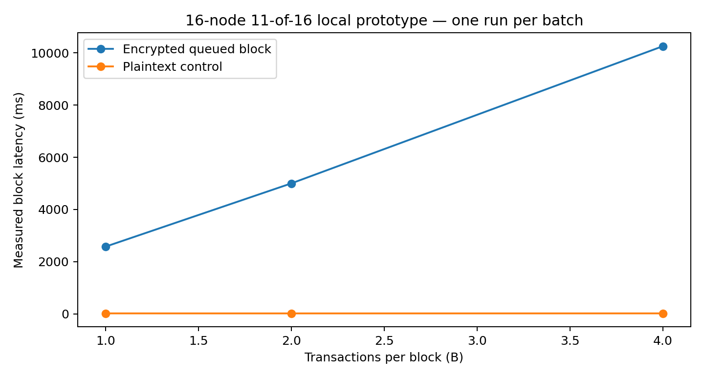
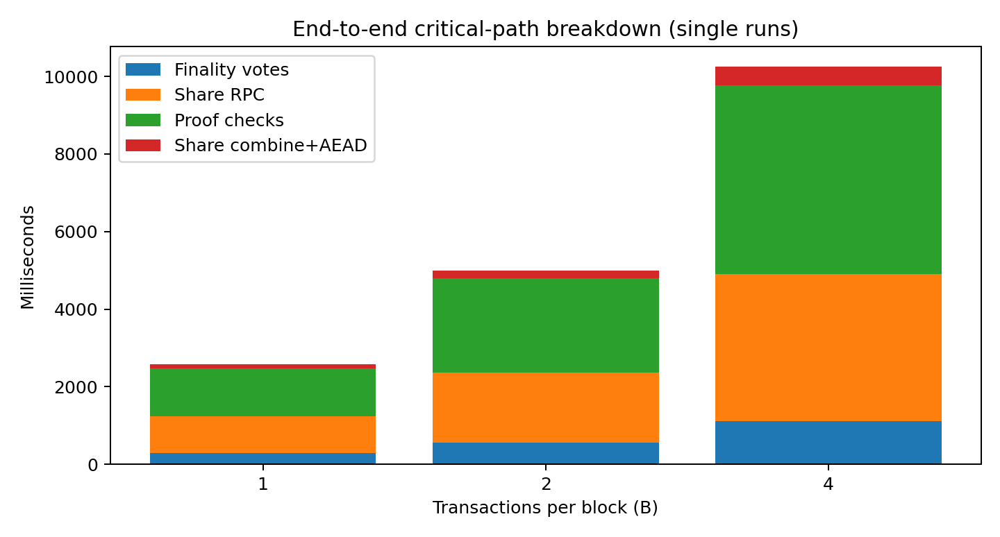

# ShieldedMempool v2 — Verified implementation results and limitations

**Date:** November 10, 2026. All v2 timing numbers below were measured on the tool-provided execution environment with 16 independent Python TCP committee processes and a threshold of 11-of-16. No cloud deployment, WAN benchmark or real blockchain was used.

## 1. Verified features

- Independently written dealer-assisted polynomial Shamir/Feldman threshold key generation, KEM / authenticated envelope, partial decryption, proof checks and Lagrange combination.
- External local TCP gateway, encrypted transaction submission and SQLite pending queue with FIFO/declared-priority selection, duplicate rejection and finalized/included states.
- Order-vote / finality certificate gating, with 16 independent committee OS processes.
- Attack against a deliberately unauthenticated XOR ciphertext, executed through committee TCP services. The attacker's chosen related ciphertext was included; the victim original remained pending; the attacker recovered the original. A separately enabled naive epoch-key-release RPC leaked an excluded pending transaction.
- Defended test rejects the modified authenticated ciphertext at the queue and committee proposal stage and refuses the insecure epoch-key RPC. This does **not** establish general adaptive CCA2 security.
- An insecure algebra-only BTX demonstration shows why O(n) aggregate shares are mathematically possible; its publicly exposed toy exponents make it insecure and it is **not the live cryptosystem**.
- An indexed collision scheduling example models BEAT-MEV's relevant tradeoff; it does not implement its puncturable PRF construction.
- A deterministic constant-product AMM sandwich demonstrates how transaction visibility enables a specific MEV strategy (not observed historical losses).

## 2. Actual 16-node queued-block measurements

Source: `results/v2/queue_benchmark/benchmark.json`. Each batch size was executed **once**; do not infer stable percentiles from these samples. Plaintext baseline used the same coordinator finality-vote path, without threshold share release.

| B | Queue admission + client encryption (ms) | Plaintext control (ms) | Encrypted block (ms) | Added block latency (ms) | Post-finality (ms) |
|---:|---:|---:|---:|---:|---:|
| 1 | 119.8 | 18.3 | 2,574.4 | 2,556.1 | 2,293.2 |
| 2 | 240.5 | 17.2 | 4,999.0 | 4,981.8 | 4,446.9 |
| 4 | 460.4 | 18.3 | 10,256.8 | 10,238.6 | 9,146.4 |

### Detailed phase breakdown (ms)

| B | Ordering/certification | Share RPC and network | Share-proof verification | Combination + AES-GCM |
|---:|---:|---:|---:|---:|
| 1 | 280.7 | 958.3 | 1,229.6 | 105.3 |
| 2 | 551.5 | 1,819.1 | 2,427.0 | 200.8 |
| 4 | 1,109.9 | 3,785.8 | 4,877.1 | 483.6 |

### Measured serialized protocol traffic

These are client coordinator-to-committee JSON RPC bytes, **not** exhaustive internal OS transport bytes, not blockchain consensus traffic and not the theoretical 80-byte shares of USENIX's optimized BTE.

| B | Sent bytes | Received bytes |
|---:|---:|---:|
| 1 | 95,184 | 38,666 |
| 2 | 156,016 | 73,542 |
| 4 | 277,552 | 143,306 |

This baseline grows roughly linearly in B because every node verifies and decrypts every ciphertext. Python modular exponentiation, proof checks, JSON serialization and the local scheduling model are substantial contributors. The measured O(nB) communication is expected; real BTE schemes address this bottleneck with additional pairing-based mathematics and security assumptions.

## 3. Integrated network attack results

Source: `results/v2/network_attacks.json`, 16-node TCP networks in both insecure and defended modes.

| Check | Observed |
|---|---|
| Attacker's modified naive ciphertext selected instead of victim | Pass |
| Excluded victim remains pending after that block | Pass |
| Naive related-ciphertext attack recovers original victim plaintext | Pass |
| 11 key shares released in intentionally vulnerable epoch mode | Pass |
| Vulnerable epoch-key release opens excluded pending ciphertext | Pass |
| Secure gateway rejects malformed modified ciphertext before inclusion | Pass |
| Secure committee refuses modified proposal and early share release | Pass |
| Secure committee refuses raw epoch-key share disclosure | Pass |

Both vulnerable and defended blocks completed their **normal** quorum workflows, and the malicious behaviors were constrained to the intentionally unsafe branch. The cryptographic security of other or hypothetical attacks is not proven by these tests.

## 4. Fault injection results

Source: `results/v2/faults_same_committee/faults.json`. Seven scenarios were executed **over the same live 16-node committee**, changing authenticated fault-injection settings between blocks; unreachable processes were simulated by omitting their RPCs. Additional individually-run evidence remains in `results/v2/fault_suite_individual_runs.json`.

| Scenario | Reachable | Outcome | Elapsed |
|---|---:|---|---:|
| Healthy | 16 | Decrypted | 2,680 ms |
| Two unreachable | 14 | Decrypted | 2,407 ms |
| Five unreachable | 11 | Decrypted | 2,239 ms |
| Three invalid share proofs | 16 | Decrypted; 3 share responses rejected | 2,982 ms |
| Three withholding shares | 16 | Decrypted | 2,415 ms |
| Five delayed responders | 16 | Decrypted | 2,598 ms |
| Six unreachable | 10 | **Expected quorum failure** | 224 ms |

All seven scenario outputs were independently recorded by the new single-committee harness. These are single samples, not statistically controlled comparisons. The test control RPC is authenticated with a random coordinator token and is research-only; it must not be exposed in a production system.

Under an 11-of-16 threshold, 5 offline nodes can be tolerated but 6 cannot. With fewer than 11 votes, finality is never certified. If a block *is* certified but then loses decryptor quorum, its pending ciphertexts transition to `finalized_unopened`, never back to pending; recovery is not implemented.

## 5. Additional demonstrations

- **Symbolic BTX:** `results/v2/toy_btx.json` confirms 11 algebraic partials open a batch of 8 rather than 88 per-transaction partials. Crucially, the model also confirms **the public can decrypt without any shares**; this is an intentionally insecure educational demonstration.
- **BEAT-MEV-style index collision model:** one attacker using a victim's index prevents both from appearing in one unique-index batch. Sub-batching allows scheduling both at the cost of additional messages.
- **Synthetic x*y=k sandwich:** `results/v2/mev_sandbox.json` uses a fictional pool and nominal swap amounts. The victim receives about 0.912 fewer tokens and the synthetic attacker earns 942.4 quote units before fees outside the AMM. No real economic losses are estimated.
- **Synthetic privacy linkage:** earlier v1 `results/privacy.json` is retained as a separate, not independently reproduced in this v2 evaluation, workload; see `shielded_mempool/privacy.py`.

## 6. Test evidence

- `python -m pytest -q -m 'not integration'` — **9 passed**.
- The six integration tests were also run individually, including: standalone 16-node test, gateway RPC flow, 16-node integrated attack, encrypted-keystore restart, early-release gate, and invalid-share/quorum behavior. The tests passed on individual invocations. Long, sequential multiprocess test suites sometimes stalled in this execution environment; `scripts/run_integration_isolated.py` provides a per-test subprocess runner.

## 7. Reproducibility and improvements

1. Install requirements and run the commands in `README.md` from the project root.
2. Do not compare these local Python timings to Rust/optimized BLS12-381 paper numbers without normalizing hardware, transaction count, included phases and communication model.
3. Repeat benchmarks at least 20–30 times with controlled workload and network conditions before quoting p95/p99 or confidence intervals.
4. A production-quality extension requires DKG, mature CCA-security proofs, peer authentication, real finality/consensus, fee and spam validation, committee-independent recovery, on-chain integration, and an actual pairing-based BTE protocol.
